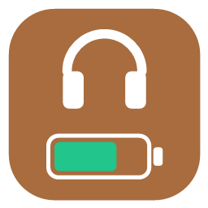
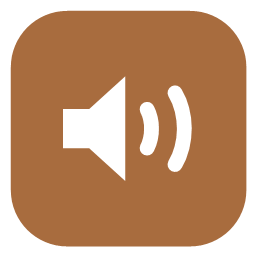
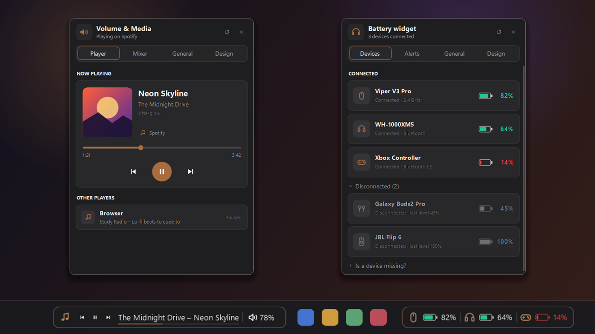
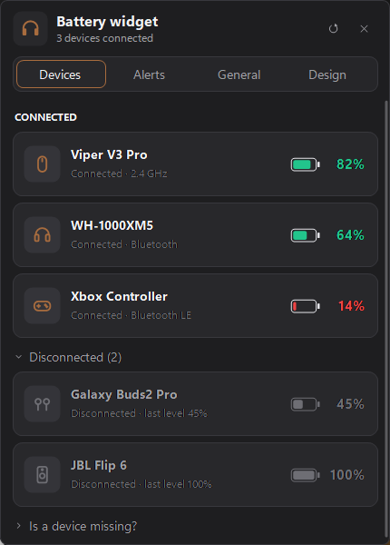
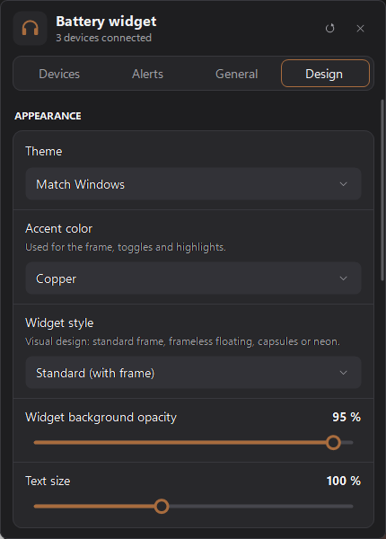
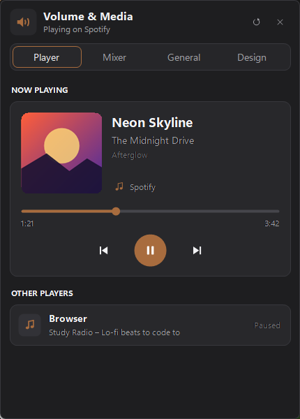
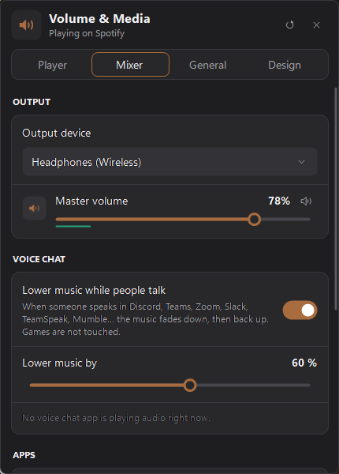
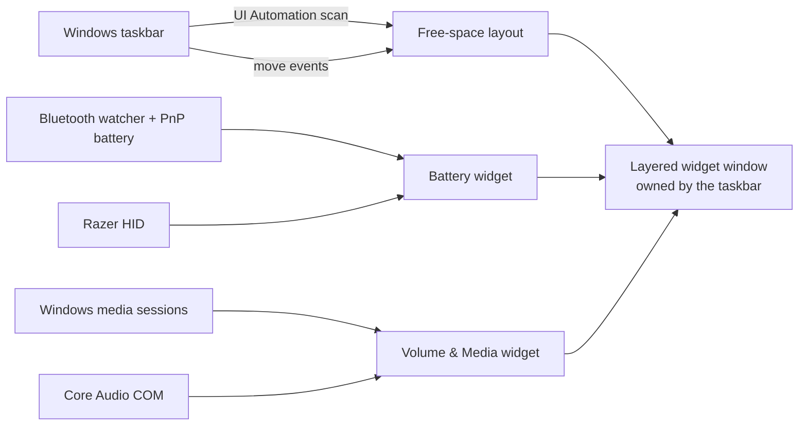

<div align="center">

&nbsp;&nbsp;&nbsp;

# Taskbar Widgets

**Battery levels of all your devices, plus what's playing and a per-app volume mixer, right on the Windows 11 taskbar.**<br>
Two tiny native widgets that sit side by side, never cover your icons, and use about 15 MB of RAM each.

[](#requirements)
[](#build-from-source)
[](#performance)
[](#install)
[](LICENSE)

[](https://github.com/W1nOfGood/taskbar-widgets/releases/latest)
[](https://github.com/W1nOfGood/taskbar-widgets/releases)
[](https://github.com/W1nOfGood/taskbar-widgets/stargazers)

<br>



<sub>Screenshots use demo data. The device names and track are made up.</sub>

</div>

---

## ✨ Highlights

<table>
<tr>
<td width="50%" valign="top">

### 🔋 Battery widget
- **Bluetooth** headphones, earbuds, speakers, mice, keyboards and controllers (classic and LE)
- **Sony** headphones read straight from the headset (accurate, unlike Windows' cached value)
- **Razer** and **Logitech** wireless receivers, **AirPods / Beats**, standard **Bluetooth LE** battery service
- **Laptop** battery
- Instant connect/disconnect, **low-battery** and **fully-charged** alerts
- Quiet by design: one low-battery alert per discharge, no popups when a mouse just falls asleep
- Blink or pulse effect when a device connects

</td>
<td width="50%" valign="top">

### 🎵 Volume & Media widget
- **Now playing** from Spotify, browsers, Media Player… with ⏮ ⏯ ⏭
- Album art, seekable timeline, switch between players
- **Scroll changes only the music app**, so your game keeps its volume (Shift = everything, Ctrl = voice chat)
- **Music ducks while friends talk** in Discord, Teams, Zoom… then fades back
- **Per-app volume mixer** with live level meters, **switch output device** in one click

</td>
</tr>
</table>

### 🧠 Smart about your taskbar
- **Never covers taskbar icons.** It reads where the Start button, app icons and tray actually are. When space gets tight it shrinks (shorter title, compact battery view) or moves to the next free gap.
- **Auto-hide taskbar**: slides up and down with it, smoothly.
- Works with **centered or left-aligned** icons, **smaller taskbar buttons**, **labels on**, Widgets/Copilot/search box, **multiple displays**, and top or side taskbars.
- Hides for **full-screen games and videos**, but not for maximized windows.
- Survives an **Explorer restart** and DPI or resolution changes.

---

## 📸 Screenshots

| Battery: devices | Battery: design |
|:---:|:---:|
|  |  |
| **Media: player** | **Media: mixer** |
|  |  |

<div align="center">
&nbsp;&nbsp;
</div>

---

## 🚀 Install

1. Download **`TaskbarWidgets.zip`** from the [latest release](https://github.com/W1nOfGood/taskbar-widgets/releases/latest).
2. Extract it anywhere (for example `C:\Tools\TaskbarWidgets`). Keep both `.exe` files in the same folder.
3. Run **`BatteryWidget.exe`** and/or **`VolumeMediaWidget.exe`**.
4. Optional: right-click a widget → **Settings** → **Start with Windows**.

> [!NOTE]
> The apps aren't code-signed, so Windows SmartScreen may warn on first launch. Click **More info → Run anyway**, or build them yourself from source (one command, below).

### Requirements
- Windows 11 (Windows 10 should work but isn't tested yet)
- .NET Framework 4.8, which is already part of Windows 10 and 11

---

## 🖱️ Using it

| Action | Battery widget | Volume & Media widget |
|---|---|---|
| **Click** | Open the panel | Media buttons, or open the panel |
| **Right-click** | Menu: position, settings, exit | Same, plus mute and sound settings |
| **Drag** | Move it along the taskbar | Move it along the taskbar |
| **Scroll** | – | Volume of the **music app only** (games untouched) |
| **Shift + scroll** | – | Master volume (everything) |
| **Ctrl + scroll** | – | Voice chat volume (Discord, Teams, Zoom…) |
| **Middle-click** / click the ♫ % | – | Mute / unmute the music app |

> [!TIP]
> **Gaming with music and voice chat?** The widget lowers only the music when you scroll, and while someone talks in Discord (or Teams, Zoom, Slack, TeamSpeak, Mumble…) it ducks the music automatically by 60%, then fades it back. Your game volume never changes. Set the amount in **Mixer → Voice chat**, or switch the scroll back to master volume in **General**.

**Position options:** *Next to Start button* · *Left side of taskbar* · *Next to clock / tray* · *Where I drag it*

---

## 🔌 Supported devices

| Brand / type | How the level is read | Status |
|---|---|---|
| **Any Bluetooth device** (classic & LE) | Windows' own Bluetooth battery value (as in *Settings → Bluetooth & devices*), with live connect/disconnect | ✅ tested |
| **Sony** headphones & earbuds | Asked **directly from the headset** over Sony's control channel, so it's accurate even when Windows shows a stale value | ✅ tested (ULT WEAR) |
| **Razer** wireless (2.4 GHz) | Razer's HID protocol, the same one Synapse uses, including charging state | ✅ tested (Viper V3 Pro) |
| **Bluetooth LE** devices with the standard Battery Service | Read directly from the device (GATT 0x180F) when Windows has no value | 🧪 untested |
| **Apple AirPods / Beats** | Decoded from the battery info they broadcast (left, right, case) | 🧪 untested |
| **Logitech** Unifying / Bolt / Lightspeed | Logitech's HID++ 2.0 protocol (unified battery, battery status or voltage) | 🧪 untested |
| Laptop battery | Windows power status | ✅ |

🧪 = built from the public protocol documentation but not yet tested on real hardware. Reports welcome!

> [!TIP]
> **Level looks wrong or stuck?** Many headsets report their battery to Windows only when they connect, so Windows' value can be hours old. Sony headsets are read directly. For other brands, turn the device off and on so it reports again.

Not yet supported: SteelSeries, Corsair and HyperX dongles, which each use a private protocol. PRs welcome!

---

## ⚡ Performance

| | Battery widget | Volume & Media widget |
|---|---|---|
| Memory (Task Manager) | ~8–17 MB | ~3–15 MB |
| CPU at idle | ~0 % (event-driven) | ~0 % (event-driven) |
| Disk | ~125 KB | ~130 KB |

How it stays this light:
- **No runtime to install, no WPF, no Electron.** It's plain WinForms with fully custom drawing.
- **Events instead of polling**: Bluetooth watcher, media session events, and Windows events for taskbar movement.
- **Raw COM** for UI Automation and Core Audio, so no extra managed libraries get loaded.
- Memory is given back after 2 minutes of idle, and never right after you use it, so clicks stay instant.

---

## 🛠️ Build from source

No SDK needed: the build uses the C# compiler that ships with Windows.

```powershell
git clone https://github.com/W1nOfGood/taskbar-widgets.git
cd taskbar-widgets
.\build.ps1 -Run            # builds bin\BatteryWidget.exe + bin\VolumeMediaWidget.exe and starts them
.\build.ps1 -Only battery   # just one app
```

<details>
<summary><b>Project layout</b></summary>

```
src/
├─ Shared/      taskbar host window, free-space layout, panel UI kit, theme, icons, raw-COM UI Automation
├─ Battery/     Bluetooth / Razer HID / system battery + battery widget & panel
└─ Volume/      Core Audio (master, per-app, output switching) + media sessions + widget & panel
docs/images/    README screenshots
build.ps1       build script (also renders the .ico files from the same vector icons)
```
</details>

<details>
<summary><b>How it works</b></summary>



- The widget is a per-pixel-alpha layered window **owned by the taskbar**. Owned windows always stay above their owner, which is the reliable way to stay on top of the Windows 11 taskbar.
- Free space = taskbar width − (Start, search, app buttons, tray) − sibling widget. The widget asks its content to fit that width.
- Panel text is drawn with GDI. GDI ignores Graphics transforms, so the scrolled content is drawn into an offscreen buffer first.
</details>

<details>
<summary><b>Debug switches</b></summary>

| Switch | Effect |
|---|---|
| `--panel N` | Open the panel on tab N at startup |
| `TW_PIN=1` | Keep the panel open when it loses focus |
| `TW_DEBUG=1` | Save the rendered widget bitmap to `%APPDATA%\TaskbarWidgets` |
| `TW_DEMO=1` | Fake devices and media (used for the screenshots), with separate settings |

Settings live in `%APPDATA%\TaskbarWidgets\*.ini`, and errors are logged to `*.log` in the same folder.
</details>

---

## ❓ FAQ

<details>
<summary><b>The widget moved somewhere else on its own</b></summary>

It never covers taskbar icons. If the spot you picked has no room left (lots of open apps), it first shrinks, then moves to the largest free gap. Close a few apps, or pick another **Position**, and it comes back.
</details>

<details>
<summary><b>Will it spam me with notifications?</b></summary>

No. The low-battery alert fires **once per discharge** and only re-arms after the device has been charged. It's remembered even across restarts. Connect/disconnect popups are **off by default** (the widget blinks instead), and dongle mice that just fell asleep never trigger anything.
</details>

<details>
<summary><b>I use two monitors</b></summary>

Turn on *Settings → Personalization → Taskbar → Show my taskbar on all displays*, then pick the display in the widget's **General → Display** setting.
</details>

<details>
<summary><b>How do I remove it?</b></summary>

Turn off *Start with Windows*, exit from the right-click menu, and delete the folder (plus `%APPDATA%\TaskbarWidgets` if you want the settings gone too).
</details>

---

<div align="center">

Made with ☕ for a cleaner taskbar · [MIT License](LICENSE)

</div>
